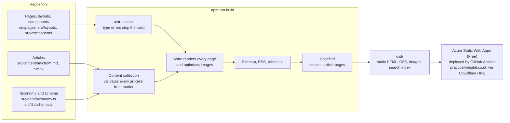

# Architecture overview

Practically Digital is a static website. Every page is built ahead of time into plain HTML, CSS and image files, and a web host serves those files as they are. No server runs code when someone visits, and there's no database. Articles are Markdown files in this repository, so the repository is the content management system.

This describes the site as built by plan 1 (site foundation) and how plan 2 (deploy and operate) tests, deploys and hosts it. The pipeline itself is described in [deployment.md](../deployment.md).

## From article to web page



The build runs in this order:

1. `astro check` type-checks every TypeScript and Astro file. Any error stops the build before anything is produced.
2. Each article's front matter (title, dates, topics, problems and so on) is checked against one schema. A typo fails the build with a message naming it: a bad value such as `topics: [digital-twin]`, or a misspelt key such as `drafts: true`. Without that, a misspelt `draft` key would publish a draft, and a bad topic would silently drop the article from a listing.
3. Astro turns each page template into HTML. Article, topic and problem pages are generated once per article or term. Images kept in an `images/` folder beside the article are converted to WebP. That covers the hero image, Markdown images (``) and the `Figure` component; the hero and `Figure` images also get smaller copies for phones. A figure with a caption or full width needs an `.mdx` article, which imports the image and passes it to `Figure`.
4. `@astrojs/sitemap` writes `sitemap-index.xml` and `sitemap-0.xml`. Two small endpoints write `rss.xml` and `robots.txt`.
5. Pagefind reads the finished article pages and writes a search index into `dist/pagefind/`. Search runs in the reader's browser against that index, so no search server is needed ([ADR-0003](../adr/0003-search-with-pagefind.md)).

Drafts are filtered out in one place, `getPublishedArticles()` in `src/lib/articles.ts`. Every page, listing and feed gets its articles from that function, which means a draft can't appear in a listing, the sitemap, the RSS feed or the search index.

### JavaScript in the browser

The site works with JavaScript turned off. Only four things use it:

- the contents pane that highlights the section you're reading
- the reading-progress bar on articles
- the search box (Pagefind's interface)
- the Cloudflare Web Analytics beacon, which counts page views without cookies. It's only on pages built with an analytics token, which in practice means the live site ([ADR-0006](../adr/0006-dns-redirects-and-analytics-on-cloudflare.md)).

With JavaScript off, contents links still jump to their sections and the search page says that search needs JavaScript.

## What each folder holds

| Folder or file | What it holds |
|---|---|
| `src/content/articles/` | The published articles, as `.md` or `.mdx`. Doesn't exist yet: the first articles arrive in plan 3, and until then every listing shows an empty state. |
| `src/content.config.ts` | Tells Astro where articles live and which schema validates them. |
| `src/data/` | Fixed data: the six topics and six problems (`taxonomy.ts`), and the author details for the About page (`author.ts`). |
| `src/lib/` | Plain TypeScript with no page markup: article selection and reading time, the front-matter schema, contents, SEO tags, robots.txt, dates, the search indexer, and the env flags. Most of it is unit-tested. |
| `src/pages/` | One file per URL or URL pattern. `insights/[slug].astro` makes every article page; `topics/[slug].astro` and `problems/[slug].astro` make the listing pages. |
| `src/layouts/` | Page shells. `BaseLayout` holds the `<head>`, header and footer; the others build on it for articles, listings and plain pages. |
| `src/components/` | Reusable pieces such as the article card, contents pane, figure and search box. |
| `src/styles/` | Plain CSS. `tokens.css` holds the "Stone and signal" colours, type scale and spacing; `prose.css` styles article text ([ADR-0002](../adr/0002-plain-css-and-ibm-plex.md)). |
| `public/` | Files copied to the site unchanged: the favicon, the default social preview image, and `staticwebapp.config.json`, which tells Azure how to answer unknown addresses (a real 404), add trailing slashes and send security headers. |
| `scripts/` | One-off tools. `make-og-image.mjs` redraws `public/og-default.png` (`npm run og`). |
| `tests/unit/` | Vitest tests for the logic in `src/lib/` and `src/data/`. |
| `tests/e2e/` | Playwright tests that load real pages in Chromium, including automated accessibility checks with axe. |
| `tests/deployed/` | Playwright checks run against a deployed site (a PR preview or production): every sitemap page with axe, the 404 status, redirects, headers, `noindex` and the analytics beacon. |
| `tests/fixtures/` | Test content: four fixture articles (one is a draft) and an empty folder for the zero-article build. Never published. |
| `docs/adr/` | Architecture decision records: the options considered for each decision and why one was chosen. |
| `docs/runbooks/` | Step-by-step instructions for everything done by hand in Azure, Cloudflare and GitHub settings. |
| `.github/` | The two workflows (`ci.yml`, `deploy.yml`), the shared setup step (`actions/setup/`) and the Dependabot settings. |
| `.githooks/` | The gitleaks pre-commit hook, turned on per clone with `git config core.hooksPath .githooks`. |
| `docs/superpowers/` | The approved design spec and the implementation plans. |
| `astro.config.mjs` | Site URL, Markdown setup and integrations (MDX, sitemap, search index). |

## Build switches (environment variables)

Five environment variables change what a build produces. The two `PUBLIC_` flags are only on when set to the exact text `true`. Anything else, including `TRUE`, `1` or a typo, counts as off, so a mistake can't publish drafts or open the site to search engines.

| Variable | Default | What it does |
|---|---|---|
| `PUBLIC_SHOW_DRAFTS` | off | When `true`, articles marked `draft: true` are built too, with a "Draft" banner. For reviewing drafts only, never for the live site. |
| `PUBLIC_ALLOW_INDEXING` | off | When off, every page carries `noindex, nofollow` and `robots.txt` blocks all crawlers. When `true`, both are lifted and `robots.txt` points to the sitemap. A build with indexing on fails while the About page still has placeholder author details. |
| `PUBLIC_CF_WEB_ANALYTICS_TOKEN` | blank | The Cloudflare Web Analytics site token. When set, every page loads Cloudflare's beacon; when blank, there's no beacon. A value that isn't 16 to 64 letters and digits fails the build. Only the production deploy sets it, from a GitHub repository variable. It's public, not a secret. |
| `PD_CONTENT_DIR` | `src/content/articles` | Where articles are read from. The tests point it at `tests/fixtures/articles`. |
| `PD_OUT_DIR` | `dist` | Where the built site is written. The tests use `dist-test` and `dist-empty`, so they don't overwrite each other or `dist`. |

To set one for a single command in the VS Code terminal (PowerShell):

```powershell
$env:PD_CONTENT_DIR = "tests/fixtures/articles"; npm run dev
```

The variable stays set until you close that terminal. `Remove-Item Env:PD_CONTENT_DIR` clears it.

## Tests

| Command | What runs | How long |
|---|---|---|
| `npm test` | Vitest unit tests: schema, taxonomy, article selection, reading time, contents, SEO tags, robots.txt, dates, author launch guard, search indexer | a few seconds |
| `npm run test:e2e` | Playwright builds the site twice (once with the fixture articles, once with none), serves both, and runs the browser tests in three projects | about a minute |
| `npm run test:deployed` | The `tests/deployed/` checks against the site at `PD_DEPLOYED_URL`. CI runs them on every preview and after every production deploy | under a minute |
| `npm run test:lighthouse` | Lighthouse CI on six pages at `PD_DEPLOYED_URL`, three runs each, failing below the thresholds in [ADR-0005](../adr/0005-ci-and-deployment-pipeline.md) | a few minutes |

The three Playwright projects are:

- `desktop` (1280 × 800) and `mobile` (375 × 812), against the fixture build
- `empty`, against the zero-article build. That build matches production until the first article ships, so it checks the empty states and that the sitemap, RSS feed and search page still work.

Every page type is checked with axe for WCAG 2.2 AA problems. At phone width the tests also check that nothing makes the page scroll sideways.

The test servers use ports 4410 and 4411, not Astro's usual 4321. If you leave `npm run dev` running, the tests won't mistake it for their own server.

## Quality scores

Lighthouse 13.6.0, mobile preset, run on 12 November 2026 against the fixture build served by `astro preview`. The production build has no articles yet, so the fixture build is the only one with an article page to test.

| Page | Performance | Accessibility | Best Practices | SEO |
|---|---|---|---|---|
| Home (`/`) | 100 | 100 | 100 | 66 |
| Article (`/insights/alpha-data-quality/`) | 100 | 100 | 100 | 69 |

SEO is low on purpose. The only failing check is "Page is blocked from indexing", which is the `noindex` tag that stays on until launch. Largest Contentful Paint was 0.8 s (home) and 0.9 s (article).

To re-run it, start the fixture build on a spare port and point Lighthouse at it:

```powershell
$env:PD_OUT_DIR = "./dist-test"; npx astro preview --port 4420 --ignore-lock
# in a second terminal:
npx lighthouse@13.6.0 http://localhost:4420/ --view
```

`dist-test` exists after `npm run test:e2e` has run. When you've finished, stop the preview with Ctrl+C and run `Remove-Item Env:PD_OUT_DIR` in that terminal. Otherwise a later `npm run build` there writes to `dist-test` instead of `dist`.

## What plan 2 added, and what plan 3 adds

### Plan 2: deploy and operate

- **Hosting** on Azure Static Web Apps, Free plan, which stops serving rather than billing if it goes over quota ([ADR-0004](../adr/0004-hosting-on-azure-static-web-apps.md)).
- **Two GitHub Actions workflows.** Every pull request is tested, scanned for secrets, deployed to its own public preview and checked there with axe and Lighthouse. Merging to `main` deploys to production and smoke-tests it ([ADR-0005](../adr/0005-ci-and-deployment-pipeline.md), [deployment.md](../deployment.md)).
- **Branch protection** on `main`: changes only through a PR whose three checks have passed.
- **Secret hygiene:** secret scanning and push protection, the gitleaks hook, Dependabot, and a leaked-secret procedure ([ADR-0007](../adr/0007-repository-secret-hygiene.md)).
- **The domain and analytics:** Cloudflare DNS, redirects for `www` and `.uk`, and cookieless Cloudflare Web Analytics on production pages only ([ADR-0006](../adr/0006-dns-redirects-and-analytics-on-cloudflare.md)).
- **Cost guardrails:** a £1 budget with alerts, an anomaly alert and a monthly check. They warn but don't cap.
- **[Runbooks](../runbooks/README.md)** for every manual step.

### Plan 3: content workflow and launch

- An article-request issue template and a `/write-article` skill for Claude Code, covering research, a humanizer pass and fact-checking.
- The first two articles: Data foundations and Digital twins.
- The real About page details, which unblocks the indexing guard.
- A launch checklist, ending with `PUBLIC_ALLOW_INDEXING=true` on the live build.

## Decisions

- [ADR-0001: Static site with Astro](../adr/0001-static-site-with-astro.md)
- [ADR-0002: Plain CSS and self-hosted IBM Plex](../adr/0002-plain-css-and-ibm-plex.md)
- [ADR-0003: Search with Pagefind](../adr/0003-search-with-pagefind.md)
- [ADR-0004: Hosting on Azure Static Web Apps (Free)](../adr/0004-hosting-on-azure-static-web-apps.md)
- [ADR-0005: CI and deployment pipeline](../adr/0005-ci-and-deployment-pipeline.md)
- [ADR-0006: DNS, redirects and analytics on Cloudflare](../adr/0006-dns-redirects-and-analytics-on-cloudflare.md)
- [ADR-0007: Repository secret hygiene and dependency updates](../adr/0007-repository-secret-hygiene.md)
- [Design spec](../superpowers/specs/2026-11-09-practically-digital-design.md)
