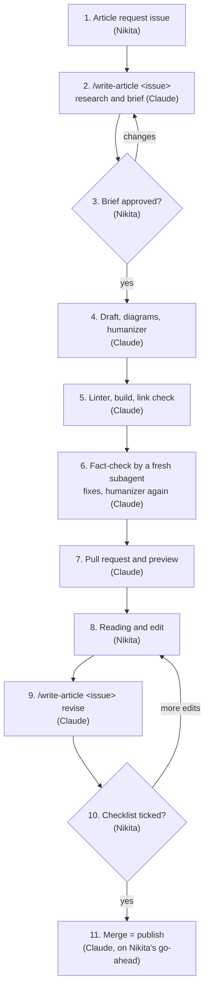

# How articles are made

This is the content workflow from the [design spec](../superpowers/specs/2026-11-09-practically-digital-design.md#decided-content-workflow), as it now runs. The reasons for each choice are in [ADR-0008](../adr/0008-content-workflow-and-checks.md).

## Who does what

| Step | Who | What happens |
|---|---|---|
| 1 | Nikita | Opens an issue with the **Article request** form: working title, main topic, reader problems, angle, the reader's problem in their words, his notes, sources he trusts, what's out of scope. |
| 2 | Claude | Runs `/write-article <issue>`. Makes the branch `article/<slug>`, researches with deep-research and writes the brief: angle, what already exists, an outline, a table of every claim and its source, candidate tools, further reading and diagrams. |
| 3 | Nikita | Approves the brief and outline, or asks for changes. Nothing is drafted before this. |
| 4 to 6 | Claude | Drafts the article from the template, draws the diagrams, runs humanizer, runs the checks, has a separate subagent fact-check every claim, and fixes what it flags. |
| 7 | Claude | Pushes the branch and opens the pull request. The preview link appears in a comment once it deploys. |
| 8 | Nikita | Reads the sources, edits the draft and adds his own angle, directly or by asking Claude. |
| 9 | Claude | Runs `/write-article <issue> revise`: checks again, fact-checks what changed, runs humanizer and shows Nikita every change it makes to his words. |
| 10 and 11 | Nikita, then Claude | Nikita ticks the [review checklist](review-checklist.md) and says go; Claude merges, and the site deploys. |

## Where things live

| What | Where |
|---|---|
| The article | `src/content/articles/<slug>.mdx`, published at `/insights/<slug>/` |
| Its diagrams | `src/content/articles/images/<slug>-<name>.svg` |
| Research brief, with the claim table | `docs/content/articles/<slug>/brief.md` |
| Fact-check report | `docs/content/articles/<slug>/fact-check.md` |
| Template | [article-template.md](article-template.md) |
| Review checklist | [review-checklist.md](review-checklist.md) |
| Issue form | `.github/ISSUE_TEMPLATE/article-request.yml` |
| The skill | `.claude/skills/write-article/SKILL.md` |
| Linter | `src/lib/article-lint.ts`, run by `npm test` on every article |
| Link checker | `npm run check:links -- <file>` (after `npm run build`) |

The brief and fact-check report are public, like everything in the repository, so they quote at most one short sentence from any source and paraphrase the rest.

## Editorial rules

- British English.
- No invented statistics, case studies or references. Every factual claim links to a source a reader can open, at the point it's made.
- A figure with no source is labelled as an estimate.
- Examples come from public sources, never client, MTC, employer or NDA work.
- Headings and the number of sections are free. The last two sections are always **Tools and resources** then **Further reading**.
- Every guide covers what it costs, its limitations and when not to bother, whatever its headings.
- Every technology guide links to the data foundations guide (`/insights/data-foundations/`), because every one of them fails on data you can't trust.
- The gist is two or three sentences: what it is, why it matters to this reader, and a one-line verdict. It appears in the highlighted box above the article.
- Diagrams are our own SVGs. Any other image is licensed, with the licence noted in the brief.
- Humanizer runs over everything published, after the last edit.
- "Would I say this out loud?" is Nikita's test.

## Sources, figures and visuals

Decided on the Data foundations pilot (November 2026).

**Links**
- Link to the publisher's page for a document (its landing page), not to the PDF, spreadsheet or zip itself, wherever such a page exists. Name the document in the link text. File addresses change when a publisher uploads a new version, and a file link on a phone starts a download. A direct file link is fine when no landing page exists.
- The brief's claim table keeps the exact file and page number, so anyone auditing a figure can still find it.

**Visuals**
- Break up text-heavy sections with the article components in `src/components/`: `StatRow` and `Stat` for headline figures, `PullQuote` for one or two verbatim quotations, `Callout` for notes and warnings, `BarChart` for one ranked series, and diagrams as our own SVGs. Every figure in them keeps its source link.
- One chart shows one survey's answers to one question. Never put different surveys on the same axes. When a chart leaves out some of a survey's answers, it says so.
- Diagrams built on invented examples say so in their caption.
- New visual elements are mocked up and shown to Nikita before they go in.

**Editing together**
- `{/* NIKITA: … */}` comments in a draft mark passages for Nikita's close review; `{/* CLAUDE: … */}` comments are Nikita's requests to Claude. They don't show on the page, and the linter fails the build while any are left.
- In Nikita's edits, Claude fixes spelling and grammar, and changes his wording only where it overstates a source, listing every change.

## Tools and resources

The second-to-last section. Tools and resources are things to *use*; Further reading is things to *read*.

- A bullet list. Each item is a link plus one line on what it's for and who it suits.
- Free, open and public resources first: standards bodies, government and Catapult guidance, open-source tools, free templates and self-assessments.
- Paid products only where they're the usual choice, labelled as paid. Never one vendor alone where there are alternatives.
- No affiliate or tracking links.
- Nothing from client or employer work.

## What the checks catch

The linter fails `npm test` (and so the `build` check on the pull request) when an article:

- doesn't end with Tools and resources then Further reading, or has either twice;
- has no bullet list under Tools and resources, or fewer than three `https` links under Further reading;
- has a percentage, money amount or "million"/"billion"/"bn" figure with no link in the same paragraph and no "estimate" label. Sources must be inline links, `[text](https://…)`, and each table row with a figure needs its own link;
- still has a marker such as TODO, TBC or [citation needed], or a `NIKITA:` or `CLAUDE:` review comment;
- links to `http://`, localhost or an Azure preview address;
- uses an American spelling (color, center, optimize and a few others) in its own prose. Names, link text, quotations and the two closing sections are exempt;
- is a technology guide with no link to the data foundations guide.

Drafts (`draft: true`) are skipped. The link checker reports each link as `ok`, `broken` (404, 410, or no such site) or `check`. "Check" means the site blocked the robot, was slow or had an error, so open it in a browser. Only `broken` fails.
