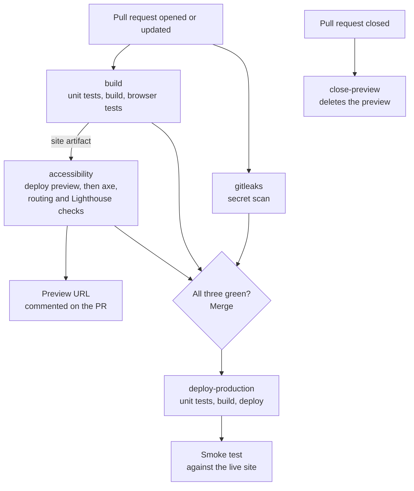

# Deployment

How a change gets from a branch to the live site, what checks it on the way, and what to do when something goes wrong. The reasons behind the design are in [ADR-0004](adr/0004-hosting-on-azure-static-web-apps.md) (hosting), [ADR-0005](adr/0005-ci-and-deployment-pipeline.md) (pipeline), [ADR-0006](adr/0006-dns-redirects-and-analytics-on-cloudflare.md) (DNS and analytics) and [ADR-0007](adr/0007-repository-secret-hygiene.md) (secrets). The manual set-up steps are in the [runbooks](runbooks/README.md).

## The pipeline

Two workflows do all of this:

| Workflow | When it runs | Jobs |
|---|---|---|
| [`ci.yml`](../.github/workflows/ci.yml) | A pull request is opened, updated, reopened or closed | `build`, `gitleaks`, `accessibility`, `close-preview` |
| [`deploy.yml`](../.github/workflows/deploy.yml) | Something lands on `main` (a merged PR), or **Run workflow** is clicked | `deploy-production` |

### On a pull request

- **`build`** runs the unit tests, builds the site the way production does (drafts off, indexing off, no analytics), and runs the browser tests. It saves the built site as an artifact called `site`.
- **`gitleaks`** scans the PR's commits for anything that looks like a secret.
- **`accessibility`** waits for `build`, deploys that same `site` to a preview environment, then runs [the deployed-site checks](../tests/deployed/site.spec.ts) and Lighthouse against it. Testing the preview is the only way to check what Azure itself does: the 404 status, the trailing-slash redirects and the security headers.
- **`close-preview`** runs when the PR is closed or merged, and deletes its preview.

The ruleset on `main` ([runbook 06](runbooks/06-branch-protection.md)) requires `build`, `gitleaks` and `accessibility` to pass before the PR can be merged.

### On merge

**`deploy-production`** runs the unit tests and builds the site again from `main`, this time with the analytics variable, deploys it, and runs the deployed-site checks against the live site. Production deploys queue rather than overlap. If two merges land close together, the second waits for the first to finish.

## Previews

- **Public.** "Anyone can access the staged versions of your application via their URL" ([Microsoft](https://learn.microsoft.com/en-us/azure/static-web-apps/review-publish-pull-requests), checked 14 November 2026). Never put anything in a PR that shouldn't be seen. They're `noindex`, like the main site until launch.
- **Three at a time.** The Free plan allows 3 preview environments per app ([quotas](https://learn.microsoft.com/en-us/azure/static-web-apps/quotas)). Microsoft doesn't say what happens when a fourth PR asks for one. We expect the deploy step in `accessibility` to fail. If it does, close or merge an older PR (which frees its slot), then re-run the failed job.
- **Deleted on close.** Closing or merging a PR deletes its preview (`close-preview`, and Microsoft's own clean-up).
- **None for Dependabot or fork PRs.** Those runs get no secrets, so `accessibility` and `close-preview` are skipped. `build` and `gitleaks` still run, and GitHub counts a skipped required check as passing: a skipped job "will report its status as 'Success'" ([GitHub](https://docs.github.com/en/actions/using-jobs/using-conditions-to-control-job-execution)).

## When a check fails

1. Open the PR, scroll to the checks, and click **Details** next to the red one. The log opens at the failing step.
2. Most failures leave reports behind. On the run's summary page (**Actions →** the run), under **Artifacts**:
   - `playwright-report-build`: the browser-test report from `build`, when it fails
   - `preview-reports`: the Lighthouse reports and the deployed-site test report from `accessibility`, kept whether it passes or fails
   - `playwright-report-production`: the smoke-test report from a failed production deploy

   Download the zip, unzip it, and open `index.html` (Playwright) or any `.report.html` (Lighthouse) in a browser.
3. Tell Claude which check failed. Don't re-run a red check hoping it goes green. If it was a flaky network blip, the retry in the test config has already had a go.

| Check | Usual causes |
|---|---|
| `build` | a failing test, a type error, an article whose front matter doesn't validate |
| `gitleaks` | something that looks like a secret in the diff. If it's real, follow [secret-leaked.md](runbooks/secret-leaked.md) first |
| `accessibility` | an axe violation, a Lighthouse score under its threshold, a fourth preview, or an expired deployment token |

## Rolling back

If a merge breaks the live site:

1. Open the merged PR on GitHub and click **Revert**. GitHub opens a new PR that undoes it.
2. Let its checks run, then merge it. That deploys the previous version.

A failing build or unit test on `main` deploys nothing: those steps run before the deploy step, so the live site stays as it was. If the smoke test fails after a deploy, the run goes red, and the site may be broken until the revert lands.

## Redeploying by hand

**Actions → Deploy → Run workflow**, branch `main`. Use this after changing the analytics variable ([runbook 08](runbooks/08-web-analytics.md)) or after rotating the deployment token.

## Quotas to watch

| What | Free limit | Where to check |
|---|---|---|
| Bandwidth | 100 GB a month, then the site stops being served | Azure portal → the Static Web App → **Metrics** (data sent) |
| Storage | 250 MB per environment, 500 MB in total | the size of `dist/` (a few MB today) |
| Files | 15,000 | the number of files in `dist/` |
| Previews | 3 at a time | open PRs |
| Custom domains | 2 | **Custom domains** (one used) |

Figures from Microsoft's [quotas page](https://learn.microsoft.com/en-us/azure/static-web-apps/quotas) and [pricing page](https://azure.microsoft.com/en-gb/pricing/details/app-service/static/), checked 14 November 2026. The monthly cost check is in [runbook 02](runbooks/02-cost-guardrails.md).

## The deployment token

The workflows deploy with one secret, `AZURE_STATIC_WEB_APPS_API_TOKEN`. To rotate it (if it leaks, or as routine), follow [secret-leaked.md](runbooks/secret-leaked.md), steps 1 to 3.
